# Chicago Crime Analytics (2012–2016)

**Exploratory analysis and data visualization using Tableau**

## Overview

I used Tableau to explore reported crime incidents in Chicago from 2012 through 2016. I compared incident counts by crime category, month, location type, police district, and arrest status. I organized the results into three dashboards and kept eight individual worksheets so each chart can also be viewed in detail.

The dashboard images are available below. Select a Tableau Public link to explore the interactive version.

## Dashboards

### 1. Citywide Crime Overview

This dashboard brings together reported incidents by category and year, monthly trends, and arrest status.

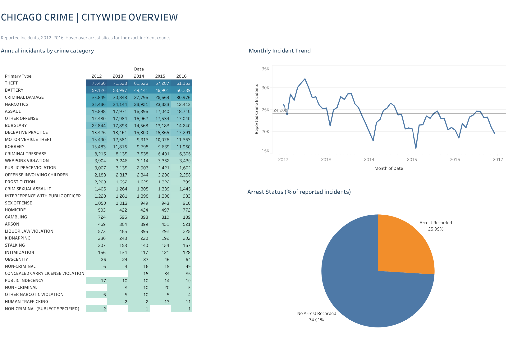

[Explore Citywide Crime Overview on Tableau Public](https://public.tableau.com/app/profile/brian.hua1739/viz/Chicago_Crime_Analytics_Dashboard_Label_Fixes/01CrimeOverview)

### 2. Locations and Police Districts

This dashboard combines a geographic density map with police district totals and reported location types. The charts show incident counts, not population-adjusted crime rates.

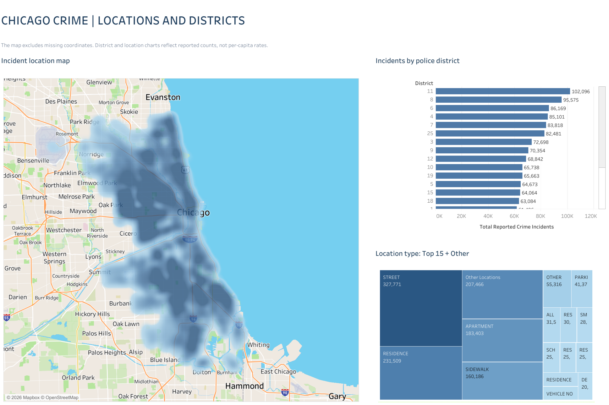

[Explore Locations and Police Districts on Tableau Public](https://public.tableau.com/app/profile/brian.hua1739/viz/Chicago_Crime_Analytics_With_Dashboards/02GeographicPatterns)

**Viewing note:** Smaller location-type labels are crowded in the dashboard treemap, and the district chart may scroll. Use the dedicated location-type and police-district worksheets below to see the larger views. The map excludes records without usable coordinates.

### 3. District-Level Patterns

This dashboard shows the distribution of reported crime categories within District 11 and weekly incident trends for Districts 8 and 11. These are separate filtered views.

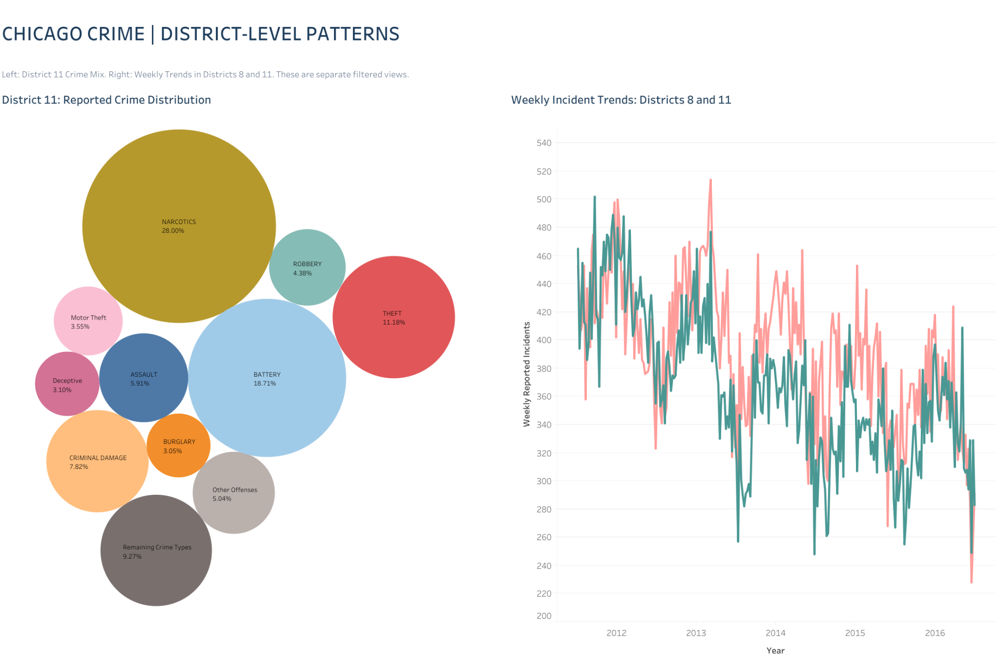

[Explore District-Level Patterns on Tableau Public](https://public.tableau.com/app/profile/brian.hua1739/viz/Chicago_Crime_Analytics_With_Dashboards/03District-LevelPatterns)

## Individual Worksheets

I also kept the eight worksheets as standalone views, making it easier to read labels and examine specific comparisons.

### 1. Crime categories by year

Comparison of reported incident counts across crime categories from 2012 to 2016.

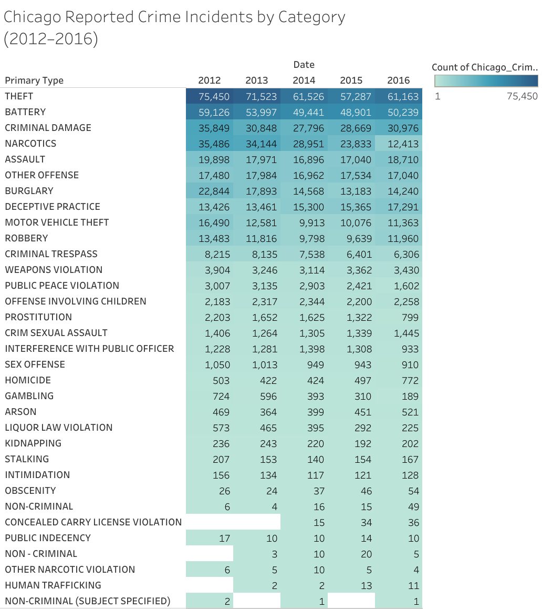

[Explore this worksheet on Tableau Public](https://public.tableau.com/app/profile/brian.hua1739/viz/Chicago_Crime_Analytics_With_Dashboards/ChicagoReportedCrimeIncidentsbyCategory20122016)

### 2. Monthly incident trends

Monthly changes in reported incident volume over the analysis period.

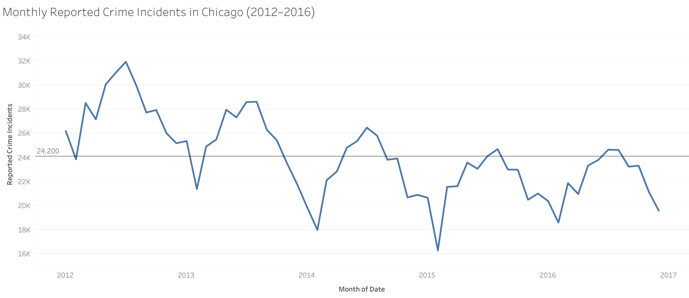

[Explore this worksheet on Tableau Public](https://public.tableau.com/app/profile/brian.hua1739/viz/Chicago_Crime_Analytics_With_Dashboards/MonthlyReportedCrimeIncidentsinChicago20122016)

### 3. Location types: Top 15 + Other

Counts by reported location description, including a grouped Other Locations category.

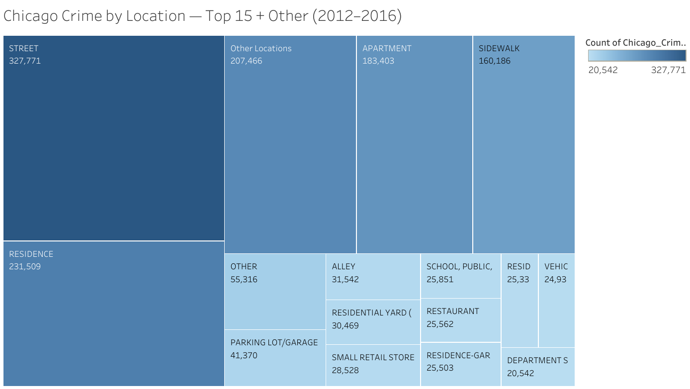

[Explore this worksheet on Tableau Public](https://public.tableau.com/app/profile/brian.hua1739/viz/Chicago_Crime_Analytics_With_Dashboards/ChicagoCrimebyLocationTop15Other20122016)

### 4. Police district comparisons

Reported incident counts by police district, ranked from highest to lowest.

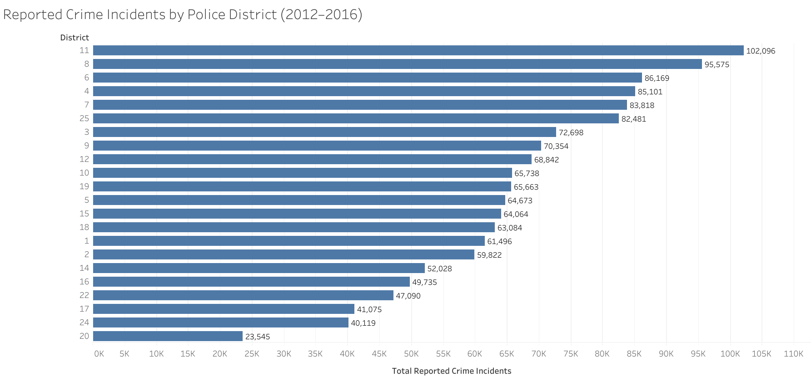

[Explore this worksheet on Tableau Public](https://public.tableau.com/app/profile/brian.hua1739/viz/Chicago_Crime_Analytics_With_Dashboards/ReportedCrimeIncidentsbyPoliceDistrict20122016)

### 5. Geographic incident density

Density map of incidents with recorded geographic coordinates.

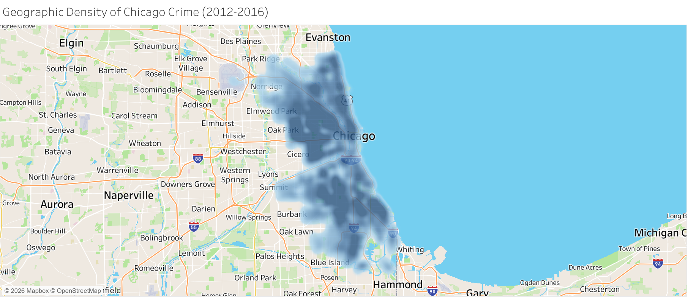

[Explore this worksheet on Tableau Public](https://public.tableau.com/app/profile/brian.hua1739/viz/Chicago_Crime_Analytics_With_Dashboards/ChicagoCrimeIncidentLocations20122016)

### 6. Crime distribution in District 11

Distribution of selected crime categories among District 11 incidents.

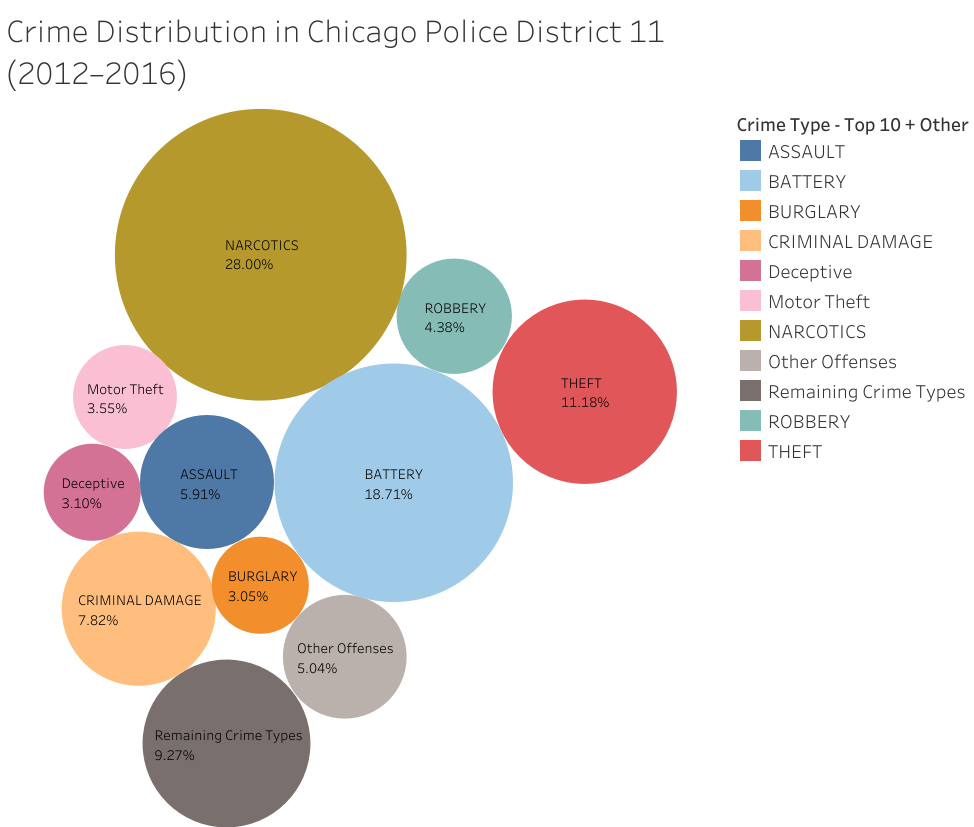

[Explore this worksheet on Tableau Public](https://public.tableau.com/app/profile/brian.hua1739/viz/Chicago_Crime_Analytics_With_Dashboards/CrimeDistributioninChicagoPoliceDistrict1120122016)

### 7. Weekly trends in Districts 8 and 11

Comparison of reported weekly incident counts in two police districts.

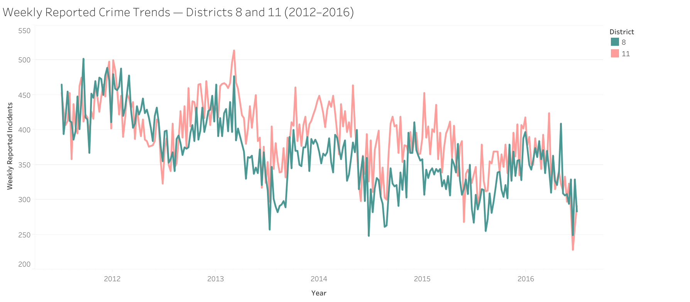

[Explore this worksheet on Tableau Public](https://public.tableau.com/app/profile/brian.hua1739/viz/Chicago_Crime_Analytics_With_Dashboards/WeeklyReportedCrimeTrendsDistricts8and1120122016)

### 8. Arrest outcomes

Share of incidents with an arrest recorded versus no arrest recorded.

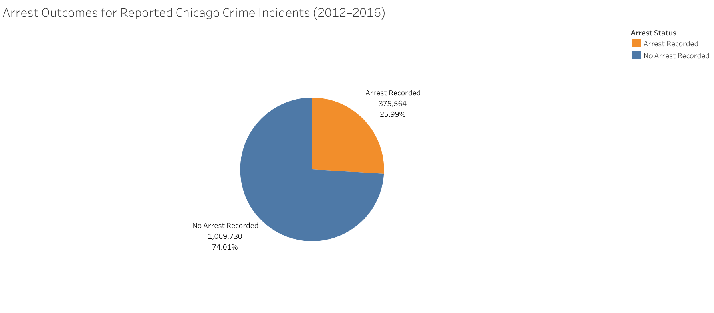

[Explore this worksheet on Tableau Public](https://public.tableau.com/app/profile/brian.hua1739/viz/Chicago_Crime_Analytics_With_Dashboards/ArrestOutcomesforReportedChicagoCrimeIncidents20122016)

## Data and Scope

- **Dataset:** [City of Chicago Data Portal, Crimes - 2001 to Present](https://data.cityofchicago.org/Public-Safety/Crimes-2001-to-Present/ijzp-q8t2)
- **Displayed period:** 2012–2016
- **Primary measure:** Counts of reported crime incidents
- **Tools:** Tableau, Tableau Public

The workbook's source connection was originally named for a 2012–2017 dataset. The updated views are filtered to 2012–2016. Exact date coverage and missing-date records still need to be checked before making final yearly comparisons.

## Tableau Workbook

The interactive dashboards and worksheets are available through the links above.

**The packaged Tableau workbook (`.twbx`) has not yet been uploaded to this repository.** The original workbook includes an embedded data extract. The repository is configured to track large `.twbx` files using Git LFS when the workbook is added.

## Preliminary Findings

The figures below are taken from the published Tableau worksheets. They describe what is displayed in the visualizations and are pending a separate reconciliation with the underlying extract and validation of the exact date coverage.

**Theft incidents declined between 2012 and 2016.** The crime-category heatmap shows 75,450 reported theft incidents in 2012 and 61,163 in 2016, a decrease of 14,287 incidents (18.9%). Theft was the highest-count category shown in both years. [View the category heatmap](images/worksheets/01-crime-categories.png).

**Recorded narcotics incidents fell more sharply.** The same heatmap shows 35,486 narcotics incidents in 2012 and 12,413 in 2016, a decrease of 23,073 (65.0%). These counts do not establish why the recorded total changed. [View the category heatmap](images/worksheets/01-crime-categories.png).

**District 11 had the highest displayed total.** The district chart lists 102,096 reported incidents for District 11, compared with 95,575 for District 8 and 86,169 for District 6 across the selected period. These are total incident counts, not population-adjusted crime rates. [View district comparisons](images/worksheets/04-police-districts.png).

**An arrest was recorded for 25.99% of displayed incidents.** The arrest-status worksheet shows 375,564 incidents with an arrest recorded and 1,069,730 without one, or 25.99% and 74.01%, respectively. Recorded arrest status does not indicate a conviction. [View arrest outcomes](images/worksheets/08-arrest-outcomes.png).

## Limitations and Remaining Checks

The dataset contains reported incidents, which do not represent every crime committed. Differences among districts and locations may reflect population, activity, enforcement, or reporting practices. The geographic density map omits incidents without usable coordinates. Visual patterns alone do not establish causation.

Before treating these preliminary observations as fully validated findings, I plan to check source date coverage, missing dates, year filters, location-type grouping logic, and the arrest-status denominator against the embedded Tableau extract.

See the [analysis review checklist](docs/ANALYSIS_NOTES.md) for those remaining checks.

## Project Files

- [Dashboard screenshots](images/)
- [Individual worksheet screenshots](images/worksheets/)
- [Image export notes](docs/EXPORT_IMAGES.md)
- [Analysis review checklist](docs/ANALYSIS_NOTES.md)

SQL scripts and independent query-performance benchmarks are not included in this version of the project.
